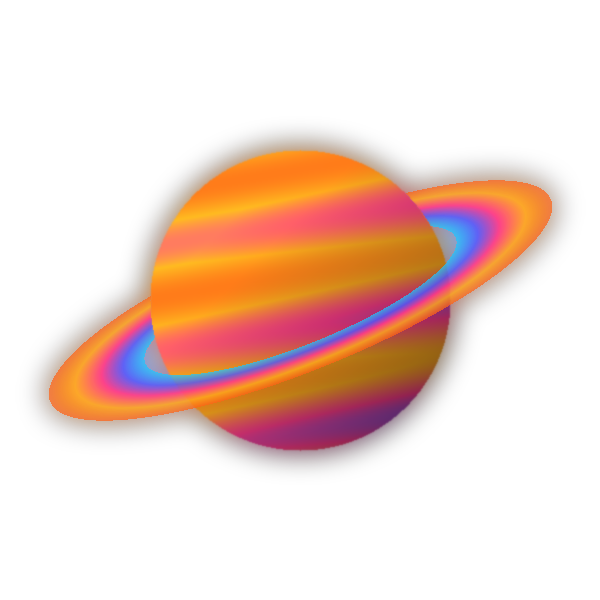

  
 
      
 <table> <tr> <td colspan="2"><h3>Olá! Eu sou o Cauã 👋</h3></td> </tr> <tr> <td width="70%" valign="top"> <b>Desenvolvedor de Software</b> · Formado em Análise e Desenvolvimento de Sistemas · Pós-graduando em Engenharia de Software   Trabalho na área de Tecnologia da Informação e estou em transição para o desenvolvimento de software, com foco na construção de aplicações modernas, escaláveis e de qualidade.   Aqui você encontra projetos dos meus estudos, desafios pessoais, experimentos e aplicações que refletem a minha evolução como desenvolvedor.   💼 Também desenvolvo sites e sistemas sob encomenda. Vamos conversar! </td> <td width="30%" align="center">  </td> </tr> </table> 
  

🚀 Stack

  

🎯 Interesses

Engenharia de Software Full Stack Arquitetura de Software Inteligência Artificial Cloud Computing DevOps

📌 Além do código
💡 Gosto de transformar ideias em soluções.
📚 Acredito em aprendizado contínuo.
🤝 Valorizo código limpo, colaboração e boas práticas.
🎵 Música e café fazem parte do meu processo criativo.
✝️ Cristão.
📊 Estatísticas

