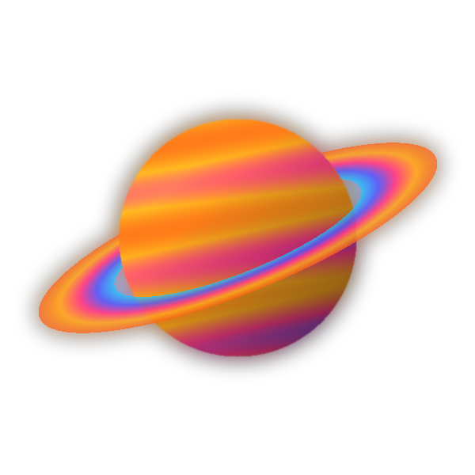

  

  
  
  
  
  

### Olá, eu sou o Cauã 👋

**Desenvolvedor de Software**

Formado em Análise e Desenvolvimento de Sistemas · Pós-graduando em Engenharia de Software

<table width="100%">
<tr>
<td width="60%" valign="middle">

Trabalho na área de Tecnologia da Informação e estou em transição para o desenvolvimento de software, com foco em aplicações modernas, escaláveis e de qualidade.

Aqui você encontra projetos dos meus estudos, desafios pessoais e experimentos que mostram a minha evolução como desenvolvedor.

💼 Também desenvolvo sites e sistemas sob encomenda. **Vamos conversar!**

</td>
<td width="40%" align="center" valign="middle">

</td>
</tr>
</table>

  

### 🚀 Stack

<table width="840" align="center">
<tr>
<td width="420" valign="top">

<h3>🎯 Interesses</h3>

<ul>
<li>Engenharia de Software</li>
<li>Full Stack</li>
<li>Arquitetura de Software</li>
<li>Inteligência Artificial</li>
<li>Cloud Computing</li>
<li>DevOps</li>
</ul>

</td>
<td width="420" valign="top">

<h3>📌 Além do código</h3>

<ul>
<li>💡 Gosto de transformar ideias em soluções</li>
<li>📚 Acredito em aprendizado contínuo</li>
<li>🤝 Valorizo código limpo e colaboração</li>
<li>🎵 Música e café fazem parte do meu processo criativo</li>
<li>✝️ Cristão</li>
</ul>

</td>
</tr>
</table>

### 📊 Estatísticas

 

